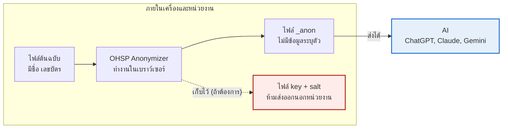

# คู่มือการใช้งาน OHSP Anonymizer

เครื่องมือทำข้อมูลนิรนามก่อนส่งให้ AI · ฉบับสำหรับผู้ใช้ทั่วไป

ปรับปรุงล่าสุด: 24 พฤศจิกายน 2569

## 1. แอปนี้ทำอะไร

OHSP Anonymizer เปลี่ยนไฟล์ข้อมูลรายบุคคลให้เป็นไฟล์ที่ **ไม่สามารถระบุตัวคนได้** ก่อนนำไปให้ AI (เช่น ChatGPT, Claude, Gemini) ช่วยวิเคราะห์ เช่น ลบชื่อ-นามสกุล ลบที่อยู่ และเปลี่ยนเลขบัตรประชาชนเป็นรหัสแทน

ทำไมต้องทำ: ข้อมูลสุขภาพรายบุคคลเป็นข้อมูลอ่อนไหวตาม พ.ร.บ.คุ้มครองข้อมูลส่วนบุคคล (PDPA) การส่งไฟล์ที่มีชื่อหรือเลขบัตรขึ้นไปบนบริการ AI ภายนอก ถือเป็นการเปิดเผยข้อมูลออกนอกหน่วยงาน

สิ่งที่ผู้ใช้ควรรู้ 3 ข้อ:

- **ข้อมูลไม่ออกจากเครื่องของคุณ** แอปทำงานในเบราว์เซอร์ (Chrome / Edge) ทั้งหมด ไม่มีการอัปโหลดไฟล์ไปที่ใด แม้จะเปิดแอปผ่านลิงก์ออนไลน์ก็ตาม
- **ผลการวิเคราะห์ยังใช้ได้เหมือนเดิม** คนเดียวกันได้รหัสแทนเดียวกันทุกแถว จึงนับจำนวนคน นับครั้งบริการ และหาค่าสถิติได้ตามปกติ
- **ไฟล์ต้นฉบับไม่ถูกแก้ไข** แอปสร้างไฟล์ใหม่ให้ดาวน์โหลด ไฟล์เดิมยังอยู่ครบ

ไฟล์ต้นฉบับ แอป และไฟล์ key อยู่ในเครื่องของหน่วยงานตลอด มีเฉพาะไฟล์ที่ชื่อลงท้าย \_anon ที่ส่งให้ AI ได้

ใช้เวลาประมาณ 2-3 นาทีต่อไฟล์ และไม่ต้องติดตั้งโปรแกรมเพิ่ม

## 2. ก่อนเริ่มใช้งาน

สิ่งที่ต้องมี:

- คอมพิวเตอร์ Windows หรือ Mac ที่มี **Google Chrome** หรือ **Microsoft Edge** (แนะนำให้ใช้บนคอมพิวเตอร์ ไม่แนะนำบนมือถือ)
- ไฟล์ข้อมูลที่จะทำนิรนาม นามสกุล .xlsx, .xls หรือ .csv เช่น ไฟล์ Data Exchange ที่ดาวน์โหลดจาก HDC
- สมุดหรือไฟล์สำหรับจดค่า **salt** (อธิบายในขั้นตอนที่ 2) ถ้าจะทำซ้ำทุกเดือน

เปิดแอปได้ 2 แบบ ผลเหมือนกันทุกอย่าง:

| แบบ | วิธีเปิด | เหมาะกับ |
| --- | --- | --- |
| ออนไลน์ (ง่ายที่สุด) | เปิดลิงก์ [nchotenin-tech.github.io/ohsp-anonymizer](https://nchotenin-tech.github.io/ohsp-anonymizer/) แล้วกดบุ๊กมาร์ก (Ctrl+D) ไว้ | ใช้ประจำ ได้เวอร์ชันล่าสุดเสมอ |
| ออฟไลน์ | ดาวน์โหลดไฟล์ `anonymizer.html` เก็บไว้ในเครื่อง แล้วดับเบิลคลิกเปิด | เครื่องที่ไม่มีอินเทอร์เน็ต หรือหน่วยงานที่บล็อกเว็บภายนอก |

วิธีดาวน์โหลดไฟล์ออฟไลน์: เข้า [หน้า GitHub ของไฟล์](https://github.com/nchotenin-tech/ohsp-anonymizer/blob/main/dist/anonymizer.html) → กดปุ่มลูกศรชี้ลง (Download raw file) มุมขวาบน → เก็บไว้ที่ Desktop

เมื่อเปิดแอปจะเห็นแถบสีเขียวเข้มด้านบนเขียนว่า "Data Anonymizer for AI" และกล่อง "เลือกไฟล์ข้อมูล" ตามด้วยขั้นตอนที่ 2-3 ที่ยังซ่อนอยู่ จะปรากฏหลังเลือกไฟล์

แอปมี 4 ขั้นตอน ทำตามลำดับจากบนลงล่าง:

1. เลือกไฟล์
2. ตรวจและปรับวิธีจัดการแต่ละคอลัมน์
3. กดประมวลผลและอ่านผลตรวจ
4. ดาวน์โหลดไฟล์ผลลัพธ์

## 3. ขั้นตอนที่ 1: เลือกไฟล์ข้อมูล

นำไฟล์เข้าแอปได้ 2 วิธี:

- **ลากวาง:** ลากไฟล์จากโฟลเดอร์มาปล่อยในกรอบเส้นประ กรอบจะเปลี่ยนเป็นสีเขียวเมื่อวางได้
- **คลิกเลือก:** คลิกที่กรอบเส้นประ → เลือกไฟล์ → กด Open

เมื่ออ่านไฟล์ได้ จะมีแถบข้อมูลใต้กรอบ ให้ตรวจ 4 จุดนี้:

| จุดที่ตรวจ | ควรเห็นอะไร | ถ้าไม่ถูกต้อง |
| --- | --- | --- |
| ชื่อไฟล์ | ชื่อไฟล์ที่เลือก | ลากไฟล์ที่ถูกต้องมาวางใหม่ |
| Sheet | sheet ที่มีข้อมูลจริง แอปเลือก sheet ที่มีคอลัมน์มากที่สุดให้ | เลือก sheet อื่นจากรายการ |
| แถวหัวตาราง | เลขแถวที่เป็นชื่อคอลัมน์ ปกติคือ 1 | ถ้าไฟล์มีหัวรายงานหลายบรรทัดก่อนตาราง ใส่เลขแถวที่เป็นชื่อคอลัมน์ เช่น 3 |
| จำนวนแถว/ฟิลด์ | เช่น "115 แถว · 43 ฟิลด์" ใกล้เคียงกับที่เห็นใน Excel | ตรวจว่าเลือก sheet และแถวหัวตารางถูกหรือไม่ |

**ไฟล์ CSV ที่ภาษาไทยเป็นตัวอ่านไม่ออก** (เช่น เห็นเป็น สภหรือ ��) ให้เปลี่ยนช่อง **Encoding CSV** จาก "อัตโนมัติ" เป็น "TIS-620 / Windows-874" หรือ "UTF-8" แอปจะอ่านใหม่ทันที ช่องนี้แสดงเฉพาะเมื่อเปิดไฟล์ CSV

## 4. ขั้นตอนที่ 2: ตั้งค่าวิธีจัดการแต่ละคอลัมน์

แอปตั้งค่าให้อัตโนมัติแล้ว สำหรับไฟล์ HDC ส่วนใหญ่ไม่ต้องแก้อะไร หน้าที่ของผู้ใช้คือ **ไล่ดูตารางให้ครบทุกแถว** ว่าไม่มีคอลัมน์ที่ระบุตัวคนหลุดรอดไป

### อ่านตารางตั้งค่า

แต่ละแถวคือ 1 คอลัมน์ในไฟล์ของคุณ:

| ช่อง | ความหมาย |
| --- | --- |
| ฟิลด์ | ชื่อคอลัมน์ ตัวหนาสีเขียว = จะถูกแปลง · ตัวเทาขีดฆ่า = จะถูกลบทิ้ง · ตัวดำปกติ = เก็บไว้ตามเดิม |
| ตัวอย่างค่า | ค่า 3 ตัวแรกจากไฟล์ ช่วยให้รู้ว่าคอลัมน์นั้นเก็บอะไร ชี้เมาส์ค้างไว้เพื่อดูเพิ่ม |
| วิธีจัดการ | เมนูเลือกว่าจะทำอะไรกับคอลัมน์นี้ (ดูตารางทั้ง 13 วิธีในภาคผนวก) |
| พารามิเตอร์ | ค่าประกอบของบางวิธี เช่น จำนวนหลักที่เก็บไว้ หรือคำนำหน้ารหัส |
| QI | ติ๊กเมื่อคอลัมน์นี้ "รวมกับคอลัมน์อื่นแล้วอาจชี้ตัวคนได้" เช่น เพศ ปีเกิด หมู่บ้าน แอปใช้คอลัมน์ที่ติ๊กไว้ตรวจความเสี่ยงในขั้นตอนที่ 3 |

ป้ายเล็กข้างชื่อคอลัมน์:

- **auto** (สีเขียว) แอปเดาเองจากชื่อคอลัมน์หรือรูปแบบค่า ควรตรวจซ้ำว่าเดาถูก
- **QI** (สีส้ม) คอลัมน์นี้ถูกใช้ตรวจความเสี่ยง
- **+hoscode** รหัสแทนของคอลัมน์นี้รวมรหัสหน่วยบริการด้วย (ใช้กับ pid เพราะ pid 1 ของ รพ.สต. หนึ่ง กับ pid 1 ของอีกแห่งเป็นคนละคน)

### เปลี่ยนวิธีจัดการ

1. คลิกเมนูในช่อง "วิธีจัดการ" ของคอลัมน์ที่ต้องการ
2. เลือกวิธีใหม่ ถ้าวิธีนั้นมีค่าประกอบ ช่องพารามิเตอร์จะปรากฏให้กรอก
3. ถ้าแก้แล้วสับสน กด **ใช้ชุดกฎนี้** ด้านบนเพื่อกลับไปค่าเริ่มต้น

หลักง่ายๆ ในการเลือก:

| ข้อมูลในคอลัมน์ | เลือก |
| --- | --- |
| ชื่อ นามสกุล เบอร์โทร อีเมล ที่อยู่ บ้านเลขที่ (ในไฟล์ HDC คือคอลัมน์ addr ย่อมาจาก address) ซอย ถนน พิกัดบ้าน | ลบทิ้ง |
| เลขบัตร ปชช., HN, pid ที่ยังต้องใช้นับคน | รหัสแทน (hash) |
| วันเกิด | วันที่ → ปี ค.ศ. หรือ วันที่ → อายุ |
| รหัสหมู่บ้าน 8 หลัก | ตัดเหลือ N หลัก (6 = ตำบล, 4 = อำเภอ) |
| หมายเหตุ ข้อความอิสระ | ล้างข้อความอิสระ หรือลบทิ้ง |
| ผลตรวจ คะแนน รหัสหน่วยบริการ วันที่รับบริการ | เก็บไว้ |

### ค่า 2 ช่องด้านบนตาราง

- **คอลัมน์ระบุตัวบุคคล:** คอลัมน์ที่บอกว่าแถวไหนเป็นคนเดียวกัน ปกติคือ `cid` ใช้เฉพาะเมื่อเลือกวิธี "เลื่อนวันที่" เพื่อให้คนเดียวกันเลื่อนเท่ากันทุกแถว ปล่อยไว้ตามที่แอปเลือกได้
- **Secret salt:** รหัสลับของหน่วยงานที่แอปใช้ตอนสร้างรหัสแทน แอปสุ่มให้ใหม่ทุกครั้งที่เปิด ถ้าทำไฟล์เดียวครั้งเดียวไม่ต้องแตะ ถ้าต้องทำซ้ำทุกเดือนให้ใส่ salt เดิม (อธิบายละเอียดในหัวข้อ 7)

## 5. ขั้นตอนที่ 3: ประมวลผลและอ่านผลตรวจ

กดปุ่ม **▶ ประมวลผล** แอปจะแสดงจำนวนแถวและฟิลด์ของผลลัพธ์ พร้อมกล่องผลตรวจสีต่างๆ แก้ค่าในขั้นตอนที่ 2 แล้วกดประมวลผลซ้ำได้ไม่จำกัดครั้ง

### ความหมายของกล่องสี

| สี | ความหมาย | ต้องทำอะไร |
| --- | --- | --- |
| เขียว | ผ่านเกณฑ์ ไม่มีกลุ่มไหนเล็กกว่า 5 คน | ไปขั้นตอนที่ 4 ได้เลย |
| เหลือง | มีบางกลุ่มเล็กกว่า 5 คน หรือแปลงวันที่บางค่าไม่ได้ | ลดความละเอียดตามตารางด้านล่าง |
| แดง | ยังมีคอลัมน์ที่น่าจะระบุตัวคนได้โดยตรง หรือกลุ่มเล็กกว่า 5 คนเกิน 20% | ห้ามส่งไฟล์ กลับไปแก้ขั้นตอนที่ 2 |

### k-anonymity คืออะไร

คือคำตอบของคำถาม "ถ้ามีคนรู้ เพศ ปีเกิด และตำบล ของเพื่อนบ้าน เขาจะหาเจอในไฟล์ได้ไหม" แอปจะจัดกลุ่มคนที่ค่า QI ตรงกันทุกคอลัมน์ แล้วดูกลุ่มที่เล็กที่สุด

- **k = 1** มีคนที่ไม่ซ้ำใคร คนที่รู้จักอาจชี้ได้ว่าแถวนั้นคือใคร
- **k = 5 ขึ้นไป** ทุกคนกลมกลืนอยู่ในกลุ่มอย่างน้อย 5 คน เป็นเกณฑ์ที่แอปใช้

### วิธีแก้เมื่อ k ต่ำกว่า 5

ลองทีละข้อตามลำดับ แล้วกดประมวลผลซ้ำจนกล่องเป็นสีเขียว:

1. รหัสหมู่บ้าน (`check_vhid`) เปลี่ยน N จาก 6 เป็น 4 (ระดับอำเภอ)
2. วันเกิดใช้ "วันที่ → ปี ค.ศ." ไม่ใช่ "ปี-เดือน"
3. อายุเปลี่ยนเป็น "ช่วงอายุ" กว้าง 5 ปี
4. ถ้าคอลัมน์ไหนไม่ได้ใช้วิเคราะห์ เปลี่ยนเป็น "ลบทิ้ง"

ก่อนไปต่อ กดแท็บ **หลังทำนิรนาม** ดูตัวอย่าง 30 แถวแรก และกด **ข้อมูลเดิม** เทียบกัน ตรวจด้วยตาว่าไม่มีชื่อ เลขบัตร หรือเบอร์โทรเหลืออยู่

## 6. ขั้นตอนที่ 4: ดาวน์โหลดผลลัพธ์

ปุ่มดาวน์โหลดอยู่ใต้ตารางตัวอย่าง ไฟล์จะไปอยู่ในโฟลเดอร์ Downloads ของเครื่อง ชื่อไฟล์จะมี `_anon` ต่อท้าย เช่น `exchange_6y_anon.xlsx`

| ปุ่ม | ได้ไฟล์อะไร | ส่งให้ AI ได้ไหม |
| --- | --- | --- |
| ⬇ ดาวน์โหลด .xlsx | ไฟล์ Excel ที่ทำนิรนามแล้ว มี sheet `anon_log` บอกวิธีที่ใช้ (ถ้าติ๊กไว้) | ได้ |
| ⬇ ดาวน์โหลด .csv | ไฟล์ CSV เปิดใน Excel แล้วภาษาไทยไม่เพี้ยน เหมาะกับ AI หรือโปรแกรมสถิติ | ได้ |
| 🔑 ดาวน์โหลดไฟล์ key | ตารางจับคู่ รหัสเดิม ↔ รหัสแทน + ค่า salt ชื่อไฟล์ลงท้าย `_KEY_SECRET` | **ห้ามเด็ดขาด** |

### ไฟล์ key ใช้ทำอะไร

ใช้เมื่อ AI พบผู้ป่วยที่ต้องติดตาม เช่น เด็กที่ฟันผุหลายซี่ เจ้าหน้าที่ในหน่วยงานนำรหัสแทน (เช่น `C-a33ce879f6e3`) มาค้นในไฟล์ key ด้วย Ctrl+F เพื่อหาเลขบัตรจริง ถ้าไม่ต้องติดตามรายคน ไม่ต้องดาวน์โหลดไฟล์ key เลยจะปลอดภัยที่สุด

ถ้าดาวน์โหลดไฟล์ key แล้ว:

- ย้ายออกจากโฟลเดอร์ Downloads ไปเก็บในโฟลเดอร์ที่มีสิทธิ์เข้าถึงจำกัด
- ห้ามแนบไฟล์ key ไปกับไฟล์ผลลัพธ์ ห้ามอัปโหลดให้ AI ห้ามส่งในกลุ่ม LINE
- ระวังอย่าให้สับสนกับไฟล์ผลลัพธ์ ดูที่ชื่อไฟล์: มี `_KEY_SECRET` = ห้ามส่ง

## 7. Secret salt และไฟล์ตั้งค่า .json (สำหรับการทำซ้ำทุกเดือน)

สองสิ่งนี้ทำให้ผลลัพธ์เหมือนเดิมทุกครั้ง: **salt** ทำให้คนเดิมได้รหัสแทนเดิม ส่วน **ไฟล์ .json** ทำให้ไม่ต้องตั้งค่าคอลัมน์ใหม่ทุกเดือน

### Secret salt คืออะไร

Salt คือ **รหัสลับประจำหน่วยงาน** เป็นตัวอักษรและตัวเลขยาวๆ เช่น `2f56e5754c4e923210d31e4f` ตอนแปลงเลขบัตรเป็นรหัสแทน แอปจะนำเลขบัตรมาผสมกับ salt ก่อนเสมอ

เปรียบเทียบกับการปรุงอาหาร: เลขบัตรคือวัตถุดิบ salt คือสูตรลับของร้าน รหัสแทนคืออาหารที่ออกมา

- วัตถุดิบเดิม + สูตรเดิม = รสชาติเดิมทุกครั้ง → คนเดิมได้รหัสแทนเดิม
- คนนอกชิมอาหารแล้วบอกสูตรไม่ได้ → เห็นรหัสแทนแล้วย้อนกลับไปหาเลขบัตรไม่ได้
- เปลี่ยนสูตร = รสชาติเปลี่ยนทันที → salt ใหม่ทำให้คนเดิมได้รหัสแทนคนละตัว

ตัวอย่างเลขบัตรสมมติเดียวกัน:

| เลขบัตร | salt | รหัสแทนที่ได้ |
| --- | --- | --- |
| 1-3601-00012-34-5 | salt เดือน ต.ค. | C-598d034fb330 |
| 1-3601-00012-34-5 | salt เดิม (ใส่ซ้ำเดือน พ.ย.) | C-598d034fb330 (ตรงกัน เชื่อมข้อมูลได้) |
| 1-3601-00012-34-5 | salt ใหม่ที่แอปสุ่ม | รหัสอื่น (เชื่อมกับเดือนก่อนไม่ได้) |

ทำไมต้องมี salt: เลขบัตรมีรูปแบบตายตัว ถ้าแปลงตรงๆ โดยไม่มี salt คนที่มีเลขบัตรของใครสักคนสามารถแปลงเองแล้วเทียบหาในไฟล์ได้ salt ปิดทางนี้ เพราะไม่มีใครรู้สูตรนอกจากหน่วยงาน

### ต้องเก็บ salt ไว้เมื่อไหร่

| สถานการณ์ | ต้องเก็บ salt? |
| --- | --- |
| ทำไฟล์เดียว ใช้ครั้งเดียว | ไม่ต้อง |
| ทำทุกเดือน แล้วอยากดูแนวโน้มรายคน | ต้อง |
| หลายไฟล์ เช่น แฟ้มฟัน + แฟ้มบริการ แล้วอยากให้ AI เชื่อมกัน | ต้อง (ใช้ salt เดียวกันทุกไฟล์) |
| ต้องติดตามผู้ป่วยจากผลวิเคราะห์ | เก็บไฟล์ key แทน (ไฟล์ key มี salt อยู่แล้ว) |

วิธีเก็บ salt:

1. ก่อนกดประมวลผลครั้งแรก คลิกที่ช่อง Secret salt กด Ctrl+A แล้ว Ctrl+C
2. วางเก็บไว้ในที่ปลอดภัยของหน่วยงาน เช่น ไฟล์ในโฟลเดอร์ที่เข้าได้เฉพาะผู้รับผิดชอบ
3. เดือนถัดไป เปิดแอป ลบค่าในช่อง salt แล้ววาง salt เดิมลงไป **ก่อน** กดประมวลผล

ข้อห้าม: อย่ากดปุ่ม 🎲 ข้างช่อง salt ถ้าต้องการใช้ salt เดิม (ปุ่มนี้สุ่มค่าใหม่) และห้ามส่ง salt ให้ AI หรือบุคคลภายนอก

### ไฟล์ตั้งค่า .json คืออะไร

เป็นไฟล์เล็กๆ ที่ **จดจำว่าแต่ละคอลัมน์เลือกวิธีอะไร** เหมือนการบันทึกสูตรไว้ เดือนหน้าโหลดกลับมาได้ทันที ไม่ต้องไล่ตั้งใหม่ทีละคอลัมน์ มีประโยชน์มากเมื่อปรับค่าเองหลายคอลัมน์ หรือใช้กับไฟล์ที่ไม่ใช่ HDC

- **เก็บ:** ชื่อคอลัมน์ วิธีจัดการ พารามิเตอร์ QI และคอลัมน์ที่รวม (เช่น +hoscode)
- **ไม่เก็บ:** ข้อมูลผู้ป่วย และ **ไม่เก็บ salt** ต้องเก็บ salt แยกตามหัวข้อด้านบน

วิธีบันทึก (ทำครั้งแรกครั้งเดียว):

1. ตั้งค่าคอลัมน์ให้เรียบร้อย และกดประมวลผลจนผลตรวจเป็นสีเขียว
2. กดปุ่ม **💾 บันทึกการตั้งค่า (.json)** ที่มุมขวาบนของขั้นตอนที่ 2
3. ได้ไฟล์ `anon_config.json` ใน Downloads เปลี่ยนชื่อให้จำง่าย เช่น `config_แฟ้มฟัน_HDC.json` แล้วเก็บไว้คู่กับไฟล์ salt

วิธีโหลด (เดือนถัดไป):

1. เปิดแอป เลือกไฟล์ข้อมูลเดือนใหม่ก่อน
2. กด **📂 โหลดการตั้งค่า** → เลือกไฟล์ .json ที่เก็บไว้
3. แอปแจ้งว่า "ตรงกัน X/Y ฟิลด์" ถ้าตรงไม่ครบ แปลว่าไฟล์เดือนนี้มีคอลัมน์ใหม่หรือชื่อเปลี่ยน ให้ตรวจคอลัมน์ที่เหลือด้วยตา
4. วาง salt เดิมลงช่อง Secret salt แล้วกดประมวลผล

ไฟล์ .json นี้แชร์ให้เพื่อนร่วมงานได้ เพราะไม่มีข้อมูลผู้ป่วยและไม่มี salt หน่วยงานสามารถใช้ไฟล์ตั้งค่าเดียวกันทั้งจังหวัดเพื่อให้ทำนิรนามแบบเดียวกัน

## 8. ตัวอย่างการใช้งานจริง

### ตัวอย่างที่ 1: ไฟล์ Data Exchange จาก HDC (แฟ้มฟันเด็ก)

ไฟล์ตัวอย่าง 115 แถว 43 คอลัมน์ ใช้ค่าเริ่มต้นได้เลยโดยไม่ต้องแก้:

| คอลัมน์ | ก่อน | หลัง |
| --- | --- | --- |
| cid | เลขบัตร 13 หลัก | C-c77bc84667ab |
| pid | 1 | P-e1db711f27ee |
| name, lname | เมฆสู\*\*\*\*\*, ณภ\*\*\* | (ลบทิ้ง) |
| addr (บ้านเลขที่) | 1 | (ลบทิ้ง) |
| birth | 2019-03-29 | 2019 |
| check\_vhid | 36010203 | 360102 |
| ผลตรวจฟัน (pteeth, dcaries, …) | 2.0, 0.0 | 2.0, 0.0 (เหมือนเดิม) |

ผลตรวจ k ต่ำสุด = 8 ผ่านเกณฑ์ ดาวน์โหลด .csv แล้วส่งให้ AI พร้อมคำสั่ง เช่น "ช่วยสรุปอัตราฟันผุเด็กแยกตามตำบล (check\_vhid)"

### ตัวอย่างที่ 2: ไฟล์ทะเบียนที่หน่วยงานทำเอง (หัวคอลัมน์ภาษาไทย)

ไฟล์ CSV มีคอลัมน์: HN, ชื่อ, นามสกุล, เลขบัตรประชาชน, วันเกิด, เพศ, เบอร์โทร, หมายเหตุ, คะแนน

แอปตั้งค่าให้เอง (ป้าย auto):

- HN, เลขบัตรประชาชน → รหัสแทน
- ชื่อ, นามสกุล, เบอร์โทร → ลบทิ้ง
- วันเกิด 15/03/2530 → 1987 (แปลง พ.ศ. เป็น ค.ศ. ให้)
- หมายเหตุ "โทร 089-123-4567 ด่วน" → "โทร \[เบอร์โทร\] ด่วน"
- เพศ, คะแนน → เก็บไว้

สิ่งที่ผู้ใช้ต้องตรวจเอง: คอลัมน์ที่ตั้งชื่อแปลกๆ เช่น "ผู้ปกครอง" หรือ "ผู้ติดต่อ" แอปอาจเดาไม่ออกว่าเป็นชื่อคน ให้เปลี่ยนเป็น "ลบทิ้ง" เอง

## 9. Checklist ก่อนส่งไฟล์ให้ AI

ติ๊กให้ครบทุกข้อก่อนอัปโหลด:

- [ ] ไฟล์ที่จะส่งมี `_anon` ในชื่อ และไม่มี `_KEY_SECRET`
- [ ] เปิดไฟล์ดูแล้ว ไม่มีชื่อ นามสกุล เลขบัตร 13 หลัก เบอร์โทร ที่อยู่ หรือบ้านเลขที่
- [ ] ผลตรวจ k-anonymity เป็นสีเขียว (k ต่ำสุด ≥ 5)
- [ ] ไม่มีกล่องเตือนสีแดง
- [ ] ไม่ได้พิมพ์ salt หรือเลขบัตรจริงลงในคำสั่งที่พิมพ์ให้ AI
- [ ] ไฟล์ key และ salt เก็บอยู่ในโฟลเดอร์ที่ปลอดภัย ไม่อยู่ใน Downloads

| ควรทำ | ห้ามทำ |
| --- | --- |
| ส่งเฉพาะคอลัมน์ที่ต้องใช้วิเคราะห์ | ส่งไฟล์ต้นฉบับจาก HDC ให้ AI โดยตรง |
| ตรวจผลด้วยตาทุกครั้ง แม้ใช้ไฟล์ .json เดิม | ส่งไฟล์ key หรือ salt ใน LINE / อีเมล / AI |
| ลบไฟล์ต้นฉบับใน Downloads เมื่อใช้เสร็จ | ใช้แอปบนเครื่องสาธารณะแล้วทิ้งไฟล์ไว้ |
| ถามผู้ดูแลระบบเมื่อไม่แน่ใจว่าคอลัมน์ไหนระบุตัวคนได้ | คิดว่าแอปตั้งค่าถูกเสมอโดยไม่ไล่ดู |

## 10. คำถามที่พบบ่อยและการแก้ปัญหา

**ลากไฟล์ไปวางแล้วไม่มีอะไรเกิดขึ้น** ตรวจว่าไฟล์เป็น .xlsx .xls หรือ .csv และไม่ได้เปิดค้างไว้ใน Excel ถ้าไฟล์ติดรหัสผ่าน ให้เปิดใน Excel แล้วบันทึกเป็นไฟล์ใหม่ที่ไม่มีรหัสก่อน

**ภาษาไทยในตัวอย่างค่าเป็นตัวอ่านไม่ออก** เปลี่ยนช่อง Encoding CSV เป็น TIS-620 / Windows-874 (ดูหัวข้อ 3)

**ชื่อคอลัมน์กลายเป็น col1, col2 หรือเป็นข้อมูลคนไข้** แถวหัวตารางผิด เปิดไฟล์ใน Excel ดูว่าชื่อคอลัมน์อยู่แถวที่เท่าไหร่ แล้วใส่เลขนั้นในช่อง "แถวหัวตาราง"

**เดือนนี้ได้รหัสแทนไม่ตรงกับเดือนก่อน** ใช้ salt คนละตัว ให้วาง salt เดิมแล้วกดประมวลผลใหม่ (หัวข้อ 7) ถ้าหา salt เดิมไม่เจอ ดูได้ใน sheet `salt` ของไฟล์ key เดือนก่อน

**แจ้ง "แปลงวันที่ไม่ได้บางค่า"** แอปอ่านวันที่ได้ 4 แบบ: 2019-03-29, 20190329, 29/03/2019, 29/03/2562 ค่าที่เป็นแบบอื่น เช่น "29 มี.ค. 62" จะถูกปล่อยว่าง แก้รูปแบบวันที่ใน Excel ก่อน หรือยอมให้เป็นค่าว่าง

**เลข 0 นำหน้าหาย เช่น hoscode 03929 เหลือ 3929** แอปเก็บเลข 0 ไว้ครบ ถ้าเห็นหายมักเกิดจากการเปิดไฟล์ .csv ด้วย Excel ให้ใช้ไฟล์ .xlsx แทน หรือส่ง .csv ให้ AI โดยไม่ต้องเปิดแก้ใน Excel

**ไฟล์ใหญ่มาก แอปค้าง** ไฟล์หลายแสนแถวอาจใช้เวลาหลายวินาที รอให้เสร็จก่อน ถ้าค้างนาน ปิดแท็บอื่นที่ไม่ใช้ หรือแบ่งไฟล์เป็นรายอำเภอ

**กดดาวน์โหลดแล้วไม่ได้ไฟล์** เบราว์เซอร์อาจถามว่าอนุญาตให้ดาวน์โหลดหลายไฟล์ไหม ดูแถบด้านบนหรือมุมขวาบนแล้วกด อนุญาต (Allow)

**เปิดหน้าเว็บไม่ได้ (เน็ตหน่วยงานบล็อก)** ใช้แบบออฟไลน์: ขอไฟล์ `anonymizer.html` จากผู้ดูแลระบบ แล้วดับเบิลคลิกเปิดได้เลย

## 11. ภาคผนวก

### ก. วิธีจัดการทั้ง 13 แบบ

| วิธี | ทำอะไร | ตัวอย่าง | ใช้กับ |
| --- | --- | --- | --- |
| เก็บไว้ | คงค่าเดิม | 2.0 → 2.0 | ผลตรวจ รหัสหน่วยบริการ |
| ลบทิ้ง | ตัดคอลัมน์ออก | – | ชื่อ เบอร์โทร ที่อยู่ บ้านเลขที่ |
| รหัสแทน (hash) | แปลงเป็นรหัสคงที่ด้วย salt | 1360… → C-c77bc84667ab | เลขบัตร HN pid |
| รหัสเรียงลำดับ | แปลงเป็นเลขลำดับ | → ID00001 | ไฟล์เดียว ไม่เชื่อมข้ามไฟล์ |
| ปกปิดบางส่วน | เหลือ N ตัวแรก | สมชาย → ส\*\*\*\*\* | กรณีต้องเห็นบางส่วน |
| ตัดเหลือ N หลัก | ลดความละเอียดรหัส | 36010203 → 360102 | รหัสหมู่บ้าน รหัสไปรษณีย์ |
| วันที่ → ปี ค.ศ. | เหลือแต่ปี | 2019-03-29 → 2019 | วันเกิด |
| วันที่ → ปี-เดือน | เหลือปีและเดือน | 2026-02-04 → 2026-02 | วันที่รับบริการ |
| วันที่ → อายุ (ปี) | คำนวณอายุณ วันที่อ้างอิง | 2019-03-29 → 6 | วันเกิด เมื่อต้องการอายุ |
| เลื่อนวันที่ ±N วัน | เลื่อนสุ่ม คนเดียวกันเลื่อนเท่ากัน | 2026-02-04 → 2026-02-17 | วันที่ที่ต้องการเก็บช่วงห่าง |
| ช่วงอายุ/ช่วงตัวเลข | จัดกลุ่มตัวเลข | 37 → 35-39 | อายุ |
| แทนด้วยค่าคงที่ | ทุกค่าเป็นข้อความเดียวกัน | → \[ปกปิด\] | คอลัมน์ที่ต้องคงไว้แต่ไม่ใช้ค่า |
| ล้างข้อความอิสระ | ลบเลขบัตร เบอร์โทร อีเมลในข้อความ | โทร 089-… → โทร \[เบอร์โทร\] | หมายเหตุ |

ข้อควรระวัง: "ล้างข้อความอิสระ" ไม่ลบชื่อคนที่พิมพ์ไว้ในหมายเหตุ ถ้าหมายเหตุมักมีชื่อคน ให้เลือก "ลบทิ้ง"

### ข. ค่าเริ่มต้นสำหรับไฟล์ HDC

| คอลัมน์ | วิธี |
| --- | --- |
| name, lname, prename, telephone, mobile, email, passport | ลบทิ้ง |
| addr (บ้านเลขที่), houseno, road, latitude, longitude | ลบทิ้ง |
| cid | รหัสแทน C- |
| pid, hn, an, seq | รหัสแทน + hoscode |
| provider | รหัสแทน DR- |
| birth | ปี ค.ศ. (QI) |
| check\_vhid | ตัดเหลือ 6 หลัก (QI) |
| sex, age\_y, nation | เก็บไว้ (QI) |
| คอลัมน์อื่นทั้งหมด | เก็บไว้ |

ชุดกฎ "เข้มงวด" ต่างจากค่าเริ่มต้น 3 จุด: check\_vhid เหลือ 4 หลัก (อำเภอ), date\_serv เหลือปี-เดือน และลบ postcode

### ค. คำศัพท์

| คำ | ความหมาย |
| --- | --- |
| ข้อมูลนิรนาม (anonymous) | ข้อมูลที่ระบุตัวบุคคลไม่ได้ |
| รหัสแทน (pseudonym) | รหัสที่ใช้แทนตัวตนจริง ย้อนกลับได้เฉพาะผู้ที่มีไฟล์ key |
| Secret salt | รหัสลับที่ผสมก่อนสร้างรหัสแทน (หัวข้อ 7) |
| QI (quasi-identifier) | คอลัมน์ที่ไม่ใช่ตัวตนโดยตรง แต่รวมกันแล้วอาจชี้ตัวคนได้ เช่น เพศ + ปีเกิด + ตำบล |
| k-anonymity | จำนวนคนที่น้อยที่สุดที่มีค่า QI เหมือนกัน ยิ่งมากยิ่งปลอดภัย |
| ไฟล์ key | ตารางจับคู่รหัสเดิมกับรหัสแทน เก็บเป็นความลับ |
| ไฟล์ตั้งค่า .json | ไฟล์จดวิธีจัดการแต่ละคอลัมน์ ไม่มีข้อมูลผู้ป่วย |
